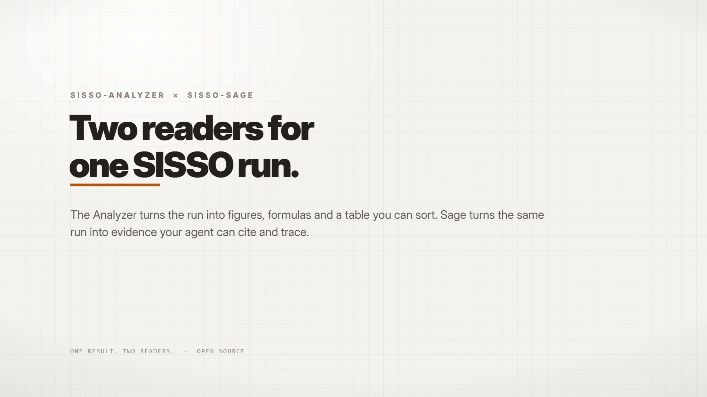

# SISSO-Analyzer

Interactive web analyzer for [SISSO](https://github.com/rouyang2017/SISSO) results. Pure client-side — nothing is uploaded; all parsing and computation runs in the browser.

**Live demo**: https://chen121760.github.io/SISSO-Analyzer/

> **Companion tool:** Use [SISSO-Sage](https://github.com/chen121760/SISSO-Sage)
> when you want an AI assistant to review several candidate formulas using
> predictive evidence, feature metadata, and extraction code. Analyzer is for
> visual, manual exploration; Sage is for AI-assisted scientific review. The two
> tools are separate but can examine the same SISSO results.

## Watch the video

[](https://chen121760.github.io/SISSO-Analyzer/promo/)

**[Watch the overview](https://chen121760.github.io/SISSO-Analyzer/promo/)** · English narration · 1080p · 48 sec

[Download MP4](https://chen121760.github.io/SISSO-Analyzer/promo/sisso-promo-en.mp4) · [English subtitles](promo/sisso-promo-en.srt)

## Scope

Single-target and multi-task (MT-SISSO) **regression**. Multi-objective and
classification tasks are not supported.

## Features

- Load the SISSO result files by drag & drop, folder, or archive (`.zip` / `.tar.gz` / …).
- Sortable overview table and thumbnail grid (rank, RMSE, MAE, MaxAE, R², Spearman's ρ) with favourites-only view.
- Health check before parsing — missing files, misaligned or non-numeric samples, unsafe descriptors — reported as Passed / Warning / Error; only real blockers stop the run.
- Per-model detail: formula, fit statistics, interactive scatter plot, point inspector, residual histogram, and per-sample CSV export.
- Copy a formula as plain text, LaTeX, or Word / PowerPoint (UnicodeMath).
- Batch tools: checkbox selection with **Copy selected** for AI prompts, and feature / descriptor usage with one-click favourite / exclude matching.
- Pareto front: any dataset × metric axes (train / verify / task 1…N / Δ gap), 2D & 3D, click-to-inspect, and CSV export of every plotted point.
- Compare models side by side — formulas, metric table, and (for two models) a shared scatter; the winning value of each metric is bolded.
- Optional `SISSO.in` shows run cards (`nsf`, `desc_dim`, `fcomplexity`, and the task split of a multi-task run).
- Auto-saved run history; favourite / exclude flags persist in saved projects.
- English / 中文 UI, light / dark theme.

## Multi-task runs (MT-SISSO)

MT-SISSO (`ntask > 1` in `SISSO.in`) reuses the single-task file names but
changes two things the analyzer has to know about. Everything else — the ranked
model file, `Uspace.expressions`, the point inspector, the usage tables — works
unchanged.

| | single-task | MT-SISSO |
|---|---|---|
| `train.dat` | one table | **one header, then the task blocks stacked vertically**, in `SISSO.in`'s `nsample=n1,n2,…` order |
| `verify.dat` | optional hold-out file | **not produced** — there is nothing to hold out |
| `Models/top*_coeff` | header `Model_ID c0 c1 …`; one row = `[c0, c1…cn]` | header `Model_ID, [(c_i,i=0,n)_j,j=1,ntask]`; one row = **ntask consecutive `[c0, c1…cn]` blocks**, one per task |
| descriptors | — | the Uspace descriptor set is **shared by every task**; only the coefficients differ |
| `Models/top*` `RMSE`/`MaxAE` | the model's score | the **task-aggregated** score: `RMSE = sqrt(Σ wᵢ·RMSEᵢ²)` (`wᵢ = 1/ntask` for `task_weighting=1`, `wᵢ = nᵢ/Σn` for `2`) and `MaxAE = maxᵢ MaxAEᵢ` |
| `SISSO.in` / `SISSO.out` | optional extras | **needed** — `ntask` / `nsample` is what splits the stacked `train.dat` back into tasks |

What the analyzer does with that:

- **Datasets.** A multi-task run exposes `train` = the whole pooled `train.dat`
  plus one dataset per task (`t1`, `t2`, …). Every view is dataset-driven, so the
  table gains a `RMSE (task n)` column per task, the Pareto axes let you trade a
  pooled metric against a per-task one, and the thumbnails overlay the tasks in
  distinct colours. The detail dialog's "Predicted vs true" scatter draws **every
  task at once — one series, colour and symbol per task** — and its dataset
  selector (`all` by default, plus each dataset on its own) narrows that down to
  a single task when you want a closer look; the same selector drives the
  residual histogram, whose statistics panel names the slice it describes.
  (The pooled series is left out of the "all" view because it is the exact
  concatenation of the task blocks — drawing it too would double every point.)
- **Formulas.** The model-formula column shows the task 1 coefficients; the
  detail dialog and *Copy formula* list every task's formula, and the CSV export
  writes one file per dataset (`sisso-model-{rank}-t1.csv`, …).
- **Two RMSEs, both shown.** *pooled* is the error over every sample in
  `train.dat`; *SISSO overall* is the task-aggregated number SISSO writes in the
  ranked-model file (shown verbatim, not recomputed). They differ whenever
  `task_weighting=1` and the tasks have different sizes.
- **Pooled R² / ρ are flagged.** R² and ρ are computed around the pooled mean, so
  on a multi-task run the between-task spread lands in the total sum of squares
  and both read optimistically — on the shipped example run the pooled R² is
  0.61 where the mean per-task R² is 0.53, even though all three tasks share one
  target property. Those columns therefore carry a tooltip, and the health check
  warns outright when the task targets sit further apart than they vary
  internally (`mt-pooled`), which is the case where pooling stops being
  defensible at all. The per-task values and SISSO's task-aggregated RMSE are the
  numbers to read.
- **Health check.** A multi-task run reports its task split (`42 + 33 + 28 = 103`),
  re-derives SISSO's overall RMSE / MaxAE for sampled models straight from the
  coefficient blocks, and cross-checks everything the run declares against the
  layout the files actually have (declared `ntask` / `desc_dim` vs. the
  coefficient rows). Because MaxAE = maxᵢ MaxAEᵢ holds in every weighting scheme,
  a MaxAE mismatch means the task split or block order was read wrongly and is
  **blocking**, while an RMSE-only mismatch is a different aggregation
  convention and stays a warning. Missing `SISSO.in`/`SISSO.out`, counts that do
  not add up to the rows in `train.dat`, a truncated coefficient file, a
  ranked-model file that mixes descriptor dimensions, and a `ptype=2`
  (classification) run are all blocking errors. A `verify.dat` dropped in with an
  MT run is ignored with a warning — a hold-out row carries no task identity.

## Run locally

```bash
python -m http.server 8080
# or
npx serve .
```

Open http://localhost:8080.

## Tests

Dependency-free Node scripts (no `package.json`, no `node_modules`):

```bash
node test/mt_sisso.test.mjs     # MT-SISSO parsing / coefficients / aggregation
node test/ui_smoke.test.mjs     # the real app.js driven through a DOM shim
```

…plus the rest of `test/*.test.mjs`. The two suites above also use the
`dontUpdate/MT-SISSO` run as a fixture when it is present (it is not committed),
and skip that section otherwise. Against that fixture the analyzer reproduces
SISSO's own overall RMSE / MaxAE for **all 1000** ranked models to within the
6-decimal rounding of the ranked-model file — the strongest available check that
the multi-task coefficient layout is read correctly.


## About SISSO

SISSO-Analyzer works with output from [SISSO](https://github.com/rouyang2017/SISSO).
For details of the method, see:

> R. Ouyang, S. Curtarolo, E. Ahmetcik, M. Scheffler, and L. M. Ghiringhelli, Phys. Rev. Mater. 2, 083802 (2018).

## Maintainer

[chen121760](https://chen121760.github.io/)
